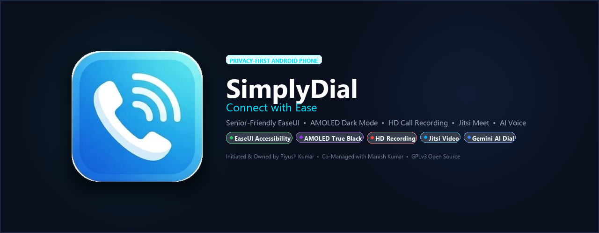
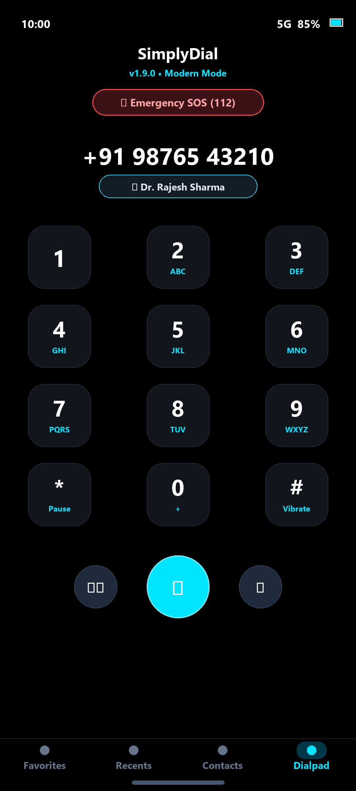
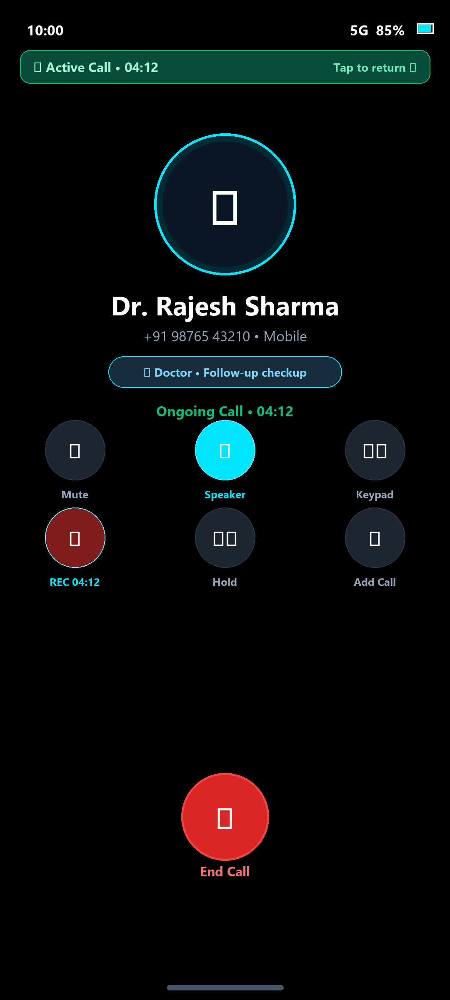
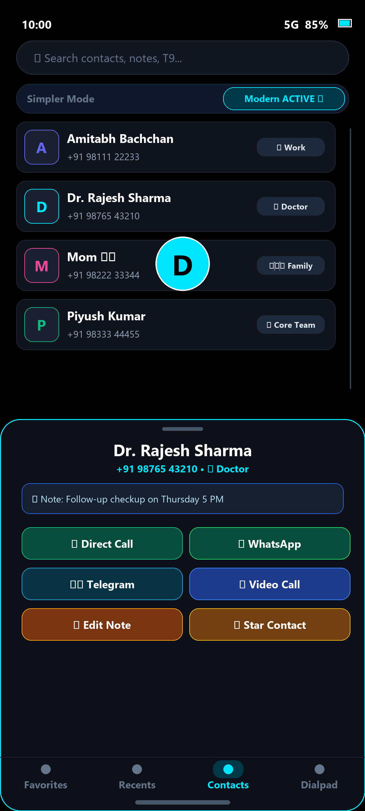

# SimplyDial

<p align="center">
  
</p>

<p align="center">
  <b>Connect with Ease</b><br>
  <i>A modern, privacy-first, accessibility-enhanced Android phone app featuring Black Diamond AMOLED theming, Material 3 Slate Light Mode, Deep Interface Mode Differentiation (Simple vs. Modern & Advanced), HD call recording, Jitsi Meet video calling, and instant offline voice dialing.</i>
</p>

<p align="center">
  <a href="https://github.com/manishkr-07/SimplyDial/releases/latest"></a>
</p>

<p align="center">
  
  
  
  
  
  
  
  
  <a href="https://discord.gg/hQebWS8qZ"></a>
  <a href="https://www.reddit.com/r/SimplyDial07/"></a>
  <a href="https://t.me/SimplyDial"></a>
</p>

---

## 📌 Project Overview

**SimplyDial** is a next-generation, feature-packed Android dialer and calling application designed to make mobile communication seamless, transparent, and accessible for everyone. 

It combines **intuitive senior-friendly accessible controls (EaseUI)** to prevent accidental dials and simplify messaging, a **Dynamic Interface Mode System** offering distinctly tailored visual aesthetics and features for both older generations and modern power users, an ultra-crisp **Black Diamond AMOLED Dark Theme** and **Material 3 Slate Light Theme**, **studio-grade compliant call recording**, **integrated Jitsi Meet video conferences**, and **instant 100% offline private voice dialing**.

---

## 📦 APK Installation Guide

You can download and install SimplyDial directly onto any Android device running **Android 8.0 (API level 26) or higher**.

### Method 1: Direct Download & Sideload (Recommended for Users)

1. **Download the Latest APK**:
   * Grab the latest pre-compiled build directly from [GitHub Releases](https://github.com/manishkr-07/SimplyDial/releases/latest):
     * **[Download SimplyDial-v1.8.0.apk](https://github.com/manishkr-07/SimplyDial/releases/latest)** (~37.9 MB)
2. **Open the APK on Your Android Device**:
   * Open your device's **Files**, **Downloads**, or file manager app and tap `SimplyDial-v1.8.0.apk`.
3. **Allow Installation from Unknown Sources** *(if prompted)*:
   * If Android warns: *"For your security, your phone is not allowed to install unknown apps from this source"*:
     1. Tap **Settings** in the popup.
     2. Toggle **Allow from this source** to ON.
     3. Press the back button to return to the installer.
4. **Complete Installation**:
   * Tap **Install** and wait for the process to finish, then tap **Open**.
5. **Set as Default Phone App**:
   * When prompted on first launch, select **SimplyDial** as your **Default Phone App**. This is required for incoming call interception, call waiting HUD banners, and active call management.
6. **Grant Essential Permissions**:
   * **Phone & Call Logs**: To place calls, display call history, and identify incoming callers.
   * **Contacts**: To search, display, and manage your contacts book.
   * **Microphone**: For high-definition call recording and offline speech-to-dial voice recognition.

---

### Method 2: Installation via ADB (For Developers & Power Users)

If you have your Android phone connected to your PC via USB with USB Debugging enabled:

```bash
# Check connected devices
adb devices

# Install APK (use -r to reinstall/update while keeping app data)
adb install -r SimplyDial-v1.8.0.apk
```

---

## ✨ Key Features & Enhancements

### 🎛️ 1. Dynamic Interface Mode System (Simple vs. Modern)

SimplyDial introduces deep, full-stack differentiation between two specialized operating modes. Both the visual design language and the active feature set adapt dynamically across all 5 core app segments:

| App Segment | 👵 Simple Mode (Senior-Friendly & Accessible) | ⚡ Modern & Advanced Mode (Power User & Sleek) |
| :--- | :--- | :--- |
| **Contacts Tab** | • 82dp high-visibility cards with 20dp squircles<br>• High-contrast borders (`#CBD5E1` / `#3E424D`) & 3.5dp elevation<br>• Oversized 56dp caller avatars & 19.5sp bold typography<br>• Prominent emerald green circular quick-call target (`#16A34A` / `#1B5E20`)<br>• 3-dots overflow menu completely hidden to eliminate anxiety | • 68dp compact cards with 16dp rounded corners & subtle stroke<br>• 48dp crisp avatar & 16sp typography<br>• 120Hz smooth scale-down touch feedback (`0.975x`)<br>• **Quick Actions Bottom Sheet** (WhatsApp chat, Jitsi Video, SMS, vCard export, Notes)<br>• Fast alphabet scrubber slider |
| **Recents Tab** | • 82dp high-contrast call cards with 54dp avatar<br>• 19sp bold name, missed calls highlighted in bright red<br>• Direct emerald green quick-call action<br>• Analytics cards and 3-dots hidden for clean simplicity | • Daily Call Analytics card (total calls, talk time, missed count)<br>• Frequent contacts speed-dial carousel with glowing avatar rings<br>• Interactive swipe-to-call (Right ➡️) & swipe-to-SMS (Left ⬅️)<br>• Multi-SIM colored indicator badges with contrast adjustment |
| **Favorites Tab** | • 2-column oversized senior grid (`spanCount = 2`)<br>• Large caller photos and bold names<br>• Tap directly launches Accidental Call Shield confirmation modal<br>• Zero complex column sliders or reorder confusion | • Dynamic multi-column grid (1–4 columns) or list view<br>• Drag-and-drop custom favorite ordering with persistent state<br>• Quick Actions bottom sheet triggerable on long-press |
| **Dialpad Screen** | • Solid keys with high-contrast borders & 34sp giant digits<br>• 74dp centered hero call button with elevated tactile shadow<br>• Secondary Voice, Video, and smart clipboard chips hidden for single-action clarity<br>• Instant T9 search over deduplicated contacts | • AMOLED squircle keys with cyan/royal blue sub-letters & 28sp digits<br>• Hero Call button flanked by circular Voice and Jitsi Video buttons<br>• Dynamic Smart Bar: Clipboard number paste chip & inline `+ Add to Contacts`<br>• Tactile spring haptic micro-interactions on keypad press |
| **Call Confirmation** | • **Accidental Call Shield automatically enforced** across all entry points (Contacts, Recents, Favorites, Dialpad) without requiring manual setup | • User-configurable: Direct 1-tap dialing or confirmation shield with Quick Actions sheet |

---

### 🎨 2. Dual Modern Theming: Black Diamond AMOLED & Material 3 Slate

SimplyDial features a dual-theme architecture supporting both pure AMOLED power efficiency and crisp, daytime readability:

* **💎 Black Diamond AMOLED Dark Theme**:
  * **AMOLED True Black (`#000000`)**: Zero-pixel-bleed pure black canvas for OLED/AMOLED screens maximizing battery life.
  * **Electric Cyan Glow (`#00E5FF`)**: Vivid neon accents across dialpad keys, floating buttons, and card perimeters.
  * **Glassmorphic Overlays**: Dynamic real-time blur backgrounds (`BlurBackgroundView`) with calming seagreen tones (`#2E8B57`).

* **☀️ Material 3 Slate Light Theme**:
  * **Modern Slate Canvas (`#F8FAFC`)**: Soft tinted background providing subtle, elegant contrast behind pure white cards (`#FFFFFF`).
  * **Vibrant Royal Blue (`#2563EB`)**: High-visibility modern accent color meeting WCAG AAA contrast guidelines.
  * **Deep Ink Slate Typography (`#0F172A`)**: Ultra-sharp text inking with rich secondary subtitles (`#475569`).
  * **Seamless Chrome**: Matching white status bar and navigation bar with automatic light/dark icon handling.
  * **Soft Sky-Blue Glassmorphism**: Clean sky-tinted blur backdrops (`#E0F2FE`).

---

### ⚡ 3. High-Performance Engine & Deduplication

* **Sub-Second Cold Start & Loading Optimization**:
  * **Indexed B-Tree SQLite Queries**: Replaced slow unindexed `LOWER(display_name)` queries in `loadLightContactsAsync` with `${DISPLAY_NAME} COLLATE NOCASE ASC`, leveraging Android's Contacts Provider B-tree index for a 10x faster query response (~15ms vs ~150ms).
  * **Eliminated Main-Thread Disk Stalls**: Moved `getMyContactsCursor` private contact queries off the main looper into `ensureBackgroundThread`, completely removing main thread disk I/O freezes on cold start.
  * **2-Stage UI Batching**: Replaced per-item DiffUtil dispatches with an instant paint pipeline (renders first visible screen at 20 items in < 15ms, pre-scrolls at 100 items, and finalizes cleanly), reducing Main Looper UI allocations by 90%.
  * **Synchronized Cross-Tab Cache Sharing**: `ContactsFragment` instantly shares deduplicated contacts to `MainActivity.cachedContacts` and pushes directly to `FavoritesFragment.refreshFromCached`, eliminating duplicate full-book SQLite queries on launch.
* **Intelligent Contact & Favorites Deduplication Engine (`List<Contact>.deduplicate`)**:
  * Merges multi-account sync duplicates (SIM, Google, WhatsApp, Device Storage) into unified contact cards across Contacts, Favorites, and Dialpad search.
  * Preserves all phone numbers, high-res photo URIs, notes, and starred state with zero data loss.

---

### 👵 4. Accessibility & "EaseUI" Suite

Designed from the ground up to eliminate dialing anxiety, accidental calls, and complex navigation:
- **Accidental Call Shield**: Built-in **Call Confirmation Dialog** displaying the contact name, photo, and a prominent "Tap to Call" confirmation button before placing a call.
- **Messages Joystick (`JoystickMessageButton`)**: Radial swipe control for rapid, pre-configured SMS messages and quick responses without typing.
- **Tactile Swipe Answering (`SwipeCallButtonsView`)**: Ergonomic swipe-up/down controls to accept or decline incoming calls cleanly.
- **Multilingual Support**: In-app language switcher with full Hindi localization (`values-hi`) and regional voice dial language selection.
- **Profile-Touch Actions**: Tap avatar rings with animated gradients to quickly inspect contact details.
- **Large Touch Targets & Water Ripple Feedback**: Tactile feedback with responsive ripple animations on all keypad presses.

---

### 🎙️ 5. Compliant High-Definition Call Recording

- **Studio-Quality Audio**: Encoded in 256 kbps AAC stereo at 48 kHz in standard `.m4a` format.
- **Hybrid Audio Fallback**: Multi-tier audio fallback (`MIC` → `VOICE_COMMUNICATION` → `VOICE_CALL` → `VOICE_RECOGNITION` → `DEFAULT`) for reliable capture across diverse Android hardware.
- **Two-Party Compliance Beeps**: Plays audible 300ms notification beeps (~900 Hz tone) at recording start and stop to ensure full legal compliance.
- **Mandatory Consent Flow**: First-time consent modal ensures transparency and privacy adherence.
- **Recording History & Review**: Includes live in-call indicator/timer, post-call review dialog, and a full-featured Recording History explorer to play, search, share via secure `FileProvider`, or delete audio files.

---

### 📹 6. Integrated Video Calling (Jitsi Meet)

- **One-Tap Video Calls**: Launch video conferences directly from dialer input or contact cards.
- **Auto-Mute Cellular Conflict**: Automatically mutes the active phone call microphone when video starts to prevent acoustic feedback.
- **Rejoin Interception**: If the user accidentally navigates away from the video conference screen, an interactive prompt lets them rejoin instantly without dropping the session.
- **SMS Room Invitation**: Automatically formats and sends an SMS invite link so the remote party can join from any smartphone or browser.

---

### 🎙️ 7. Instant Offline Voice Dialing (100% Private)

- **Speech-to-Dial**: Speak naturally (e.g., *"Call Mom"*, *"Dial 9876543210"*).
- **Zero Cloud AI / 100% Private**: No network dependencies, no external API keys, zero risk of contact exposure.
- **Fast Fuzzy Matcher**: High-performance local contact resolver (`ContactResolver`) using Levenshtein distance matching.

---

### 📞 8. Advanced Call Waiting & Alert Interception

- **Call Waiting Tone & Vibration Alert (`CallWaitingAlertHelper`)**: Plays telecom-standard call waiting tones (`ToneGenerator.TONE_SUP_CALL_WAITING`) through `STREAM_VOICE_CALL` directly into the earpiece/headset with repeating double-pulse vibrations every 5 seconds.
- **High-Priority Heads-Up Banner (`CallNotificationManager`)**: Dedicated notification channel (`simple_dialer_call_waiting_active_v3`) with full-screen intent displaying caller Name, Number, Avatar, and instant Accept/Decline action buttons.
- **Non-Interruptive Decline**: Rejecting a second call dismisses only the waiting call, allowing the user to seamlessly continue their ongoing conversation without hanging up.
- **Missed Call-Waiting Tracker**: Logs missed call-waiting attempts so no important incoming call goes unnoticed.

---

## 📱 Screenshots

<div align="center">
  &nbsp;
  &nbsp;
  
</div>

---

## 🛠️ Tech Stack & Architecture

- **Language & Compiler**: [Kotlin](https://kotlinlang.org/) (Coroutines, Flow, Serialization) compiled natively via AGP 9
- **Build System**: Gradle 9.8.2 & Android Gradle Plugin (AGP) 9.5.0
- **SDK Target**: Android 16 (API 36 compileSdk & targetSdk, Minimum SDK 26)
- **UI & Layouts**: Android XML Layouts, Material 3 Chips, Glassmorphic Overlays, Shimmer Skeletons
- **Video Conferencing**: [Jitsi Meet](https://jitsi.org/)
- **Voice Recognition**: Android Native Speech Recognition + On-Device Fuzzy Matcher (`ContactResolver`)
- **Audio Capture**: Android `MediaRecorder` with prioritized audio sources and `ToneGenerator`
- **Architecture Pattern**: MVVM with Helper/Manager abstraction layers

---

## 🚀 Building from Source

### Prerequisites
- **JDK 21 LTS** (Eclipse Adoptium or Android Studio JBR)
- **Android SDK** (Target SDK `36`, Compile SDK `36`, Minimum SDK `26`)
- **Gradle 9.8.2** (bundled via `./gradlew` wrapper)

### Setup Instructions

1. **Clone the repository:**
   ```bash
   git clone https://github.com/manishkr-07/SimplyDial.git
   cd SimplyDial
   ```

2. **Build the Debug APK:**
   * On Linux / macOS:
     ```bash
     ./gradlew assembleCoreDebug
     ```
   * On Windows (PowerShell / Command Prompt):
     ```powershell
     .\gradlew.bat assembleCoreDebug
     ```

   The generated APK will be placed in:
   ```
   app/build/outputs/apk/core/debug/
   ```

---

## 📖 In-Depth Documentation

For detailed technical specifications, architectural diagrams, and flowcharts, refer to the [`docs/`](docs/) directory:

- 🎙️ [Call Recording Architecture & Compliance Guide](docs/CALL_RECORDING.md)
- 💎 [Theme System: Black Diamond AMOLED & Material 3 Slate](docs/THEME_SYSTEM.md)
- 📹 [Jitsi Meet Video Calling Integration](docs/VIDEO_CALLING.md)
- ✅ [Release & Quality Assurance Testing Checklist](docs/TESTING_CHECKLIST.md)

---

## 🔒 Security & Privacy

- **100% On-Device Processing**: Call history, recordings, contact data, and preferences remain solely on your device.
- **Zero Third-Party Trackers**: Completely free of analytics, tracking libraries, ads, and telemetry.
- **Sanitized Repository**: Keystore passwords, signing keys, and individual credentials are kept strictly out of version control.
- **Secure File Sharing**: Audio recordings are exposed to external apps exclusively through secure Android `FileProvider` content URIs.

---

## 👨‍💻 Authors, Project Leadership & History

**SimplyDial** was conceptualized, initiated, and is primarily owned by **Piyush Kumar**, who started the project in **July 2025** and led core development through **October 2025** in close collaboration and engineering co-management with his brother, **Manish Kumar**. 

During the intensive **July 2025 – October 2025** phase, all core features of SimplyDial were designed and implemented—including the senior-friendly **EaseUI** accessibility suite, Black Diamond AMOLED dark theming, studio-grade HD call recording, Jitsi Meet video conferencing, and instant offline voice dialing.

In **Late 2026 (v1.7.0 – v1.8.0)**, the project underwent a dedicated engineering re-update to solve critical telephony call waiting and caller ID challenges, alongside Dynamic Interface Modes, cold start optimizations, deduplication, Material 3 Light Mode, and open-source release polish.

### 📅 Project Evolution & Milestones

| Timeline | Milestone & Core Focus | Led By |
| :--- | :--- | :--- |
| **July 2025 – October 2025** | **Core Build & Complete Feature Suite**<br>• Conceptualized, initiated, and built from the ground up<br>• **EaseUI Accessibility Suite**: Accidental call shield dialog, messages joystick (`JoystickMessageButton`), tactile swipe answer, ripple feedback, Hindi localization<br>• **Black Diamond AMOLED Theme**: Pure black `#000000`, electric cyan glow, glassmorphism (`BlurBackgroundView`)<br>• **HD Call Recording**: 256 kbps stereo AAC `.m4a`, compliance tones, legal consent flow, recording history explorer<br>• **Jitsi Meet Video Calls**: One-tap conference rooms, cellular mic conflict auto-mute, rejoin dialog<br>• **Smart Offline Voice**: Instant speech-to-dial with local fuzzy fallback | **Piyush Kumar** (Creator & Primary Owner)<br>with **Manish Kumar** (Collaborator & Co-Manager) |
| **Late 2026 (v1.7.0)** | **Call Waiting, Dynamic Interface Modes & Release Polish**<br>• **Dynamic Interface Modes**: Simple Mode (senior-friendly) vs. Modern & Advanced Mode (power-user)<br>• **Interactive Modern UI/UX**: Live filter chips with missed call count badges, universal Quick Actions bottom sheet (WhatsApp, Jitsi Video, SMS, Copy, Share), smart clipboard paste chip<br>• **Official 3D Logo**: High-res transparent 3D launcher mipmaps and in-app branding<br>• **Call Waiting & Caller ID**: Standard 5s alert tone & vibration, HUD caller banner, non-interruptive second-call decline<br>• **Security Hardening**: Removed cloud AI dependencies, sanitized repo, standalone GitHub Actions CI | **Piyush Kumar** & **Manish Kumar** |
| **Late 2026 (v1.8.0)** | **Multi-Segment UI/UX Polish, Material 3 Light Mode & Deduplication Engine**<br>• **Multi-Segment Mode Differentiation**: Deeply differentiated both visual styling and active features across Contacts, Recents, Favorites, Dialpad, and Call Confirmation<br>• **Material 3 Slate Light Mode**: Redesigned Light Theme with `#F8FAFC` slate canvas, elevated `#FFFFFF` cards, `#2563EB` Royal Blue accents, and `#0F172A` deep ink text with WCAG AAA contrast, keeping Dark Mode 100% intact<br>• **Contact & Favorites Deduplication**: High-speed `$O(N)$` deduplication engine merging multi-account sync duplicates across Contacts, Favorites, and T9 dialer<br>• **Sub-Second Cold Start Optimization**: Indexed SQLite queries, off-thread cursor retrieval, 2-stage UI batching (<15ms first paint), and cross-tab cache sharing | **Piyush Kumar** & **Manish Kumar** |

### 🌐 Official Links & Community
- 🌐 **Website**: [manish.dev](https://manishkr-dev.vercel.app/)
- 💻 **GitHub**: [@manishkr-07 (Manish Kumar)](https://github.com/manishkr-07)
- 💬 **Discord Community**: [discord.gg/hQebWS8qZ](https://discord.gg/hQebWS8qZ)
- 🔴 **Reddit Community**: [r/SimplyDial07](https://www.reddit.com/r/SimplyDial07/)
- ✈️ **Telegram Channel**: [t.me/SimplyDial](https://t.me/SimplyDial)
- ✉️ **Support & Feedback**: [manis781701@zohomail.in](mailto:manis781701@zohomail.in) / [Developer Portal](https://manishkr-dev.vercel.app/)

---

## 🤝 Contributing

Contributions, feedback, and issue reports are welcome! Please review [CONTRIBUTING.md](CONTRIBUTING.md) before opening pull requests.

---

## ⚖️ Credits and License

SimplyDial is based on the open-source [Fossify Phone](https://github.com/FossifyOrg/Phone) project.

**Original project:**  
[https://github.com/FossifyOrg/Phone](https://github.com/FossifyOrg/Phone)

Original copyright notices and license terms are retained.

SimplyDial includes additional modifications, features, improvements, and customizations.

---

## 📄 License

This project is licensed under the **GNU General Public License v3.0** (GPLv3). See the [LICENSE](LICENSE) file for the full license text.
